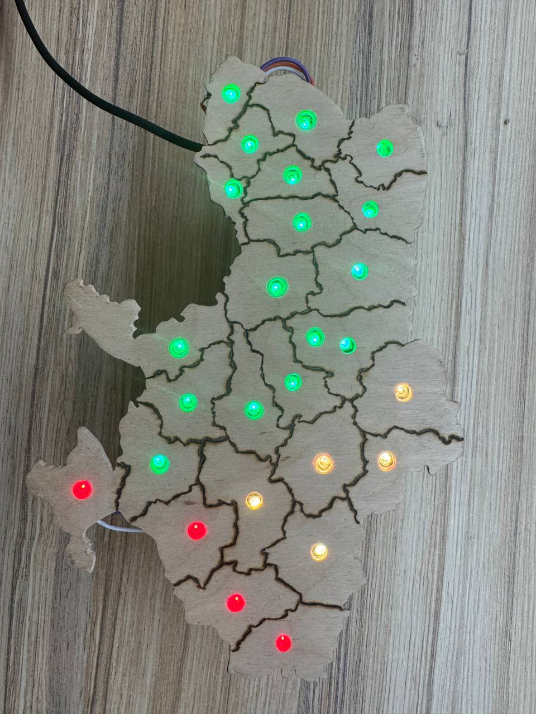

# 🗺️ ESP32 Air Raid Alert Map (IoT)

Physical interactive map of Ukraine displaying real-time air raid alerts using an ESP32 micro-controller and WS2812B LED matrix.

## 🛠 Tech Stack
* **Hardware:** ESP32-C3 Super Mini, WS2812B Addressable LEDs (26 pixels), Custom Wooden Map Structure
* **Software:** C++, `Adafruit_NeoPixel`, WiFiClientSecure, ArduinoJson
* **API:** alerts.in.ua

## 🚀 Status
**Hardware assembly and firmware development are complete.** The system successfully connects to Wi-Fi, fetches API data safely, and maps regional alerts to the corresponding LED nodes in real-time.

## 🚥 LED Colors
- 🔴 - Air raid alert in all districts of the region
- 🟡 - The air raid alert does not apply to all districts in the region
- 🟢 - There is no air raid alert
- 🟣 - Unable to retrieve alert data from the server

## 📸 Preview

